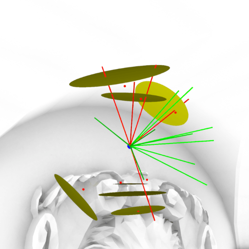
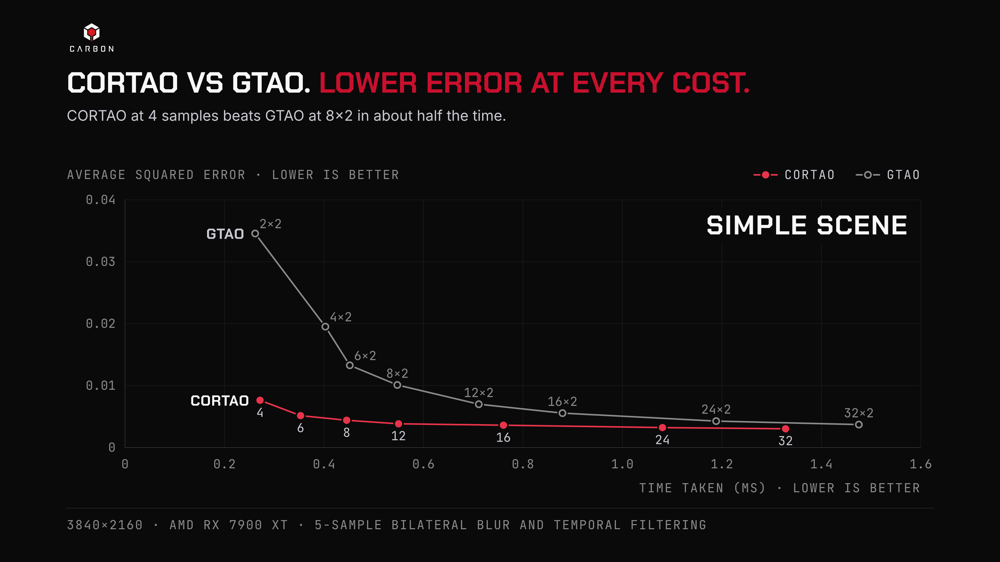
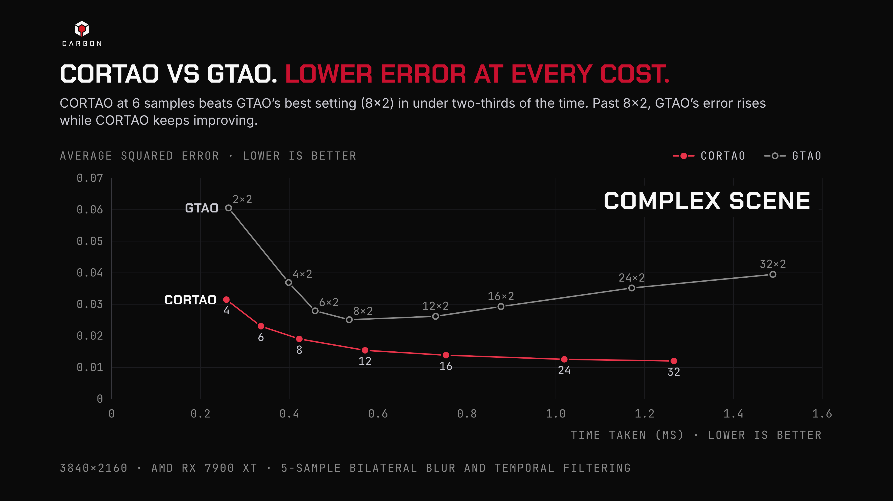
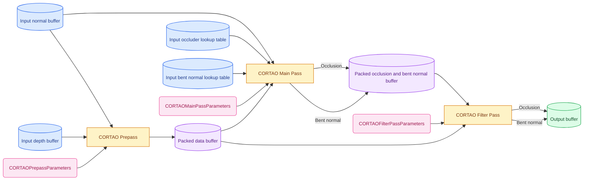
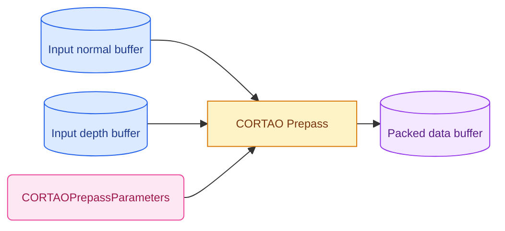
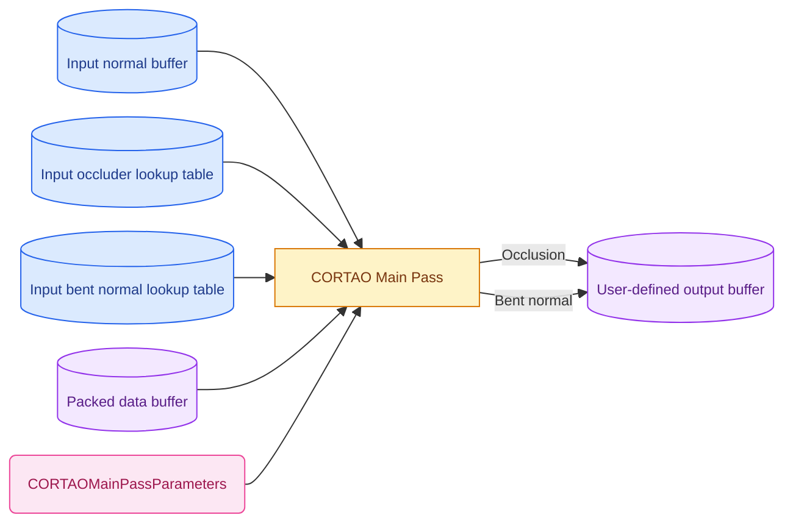
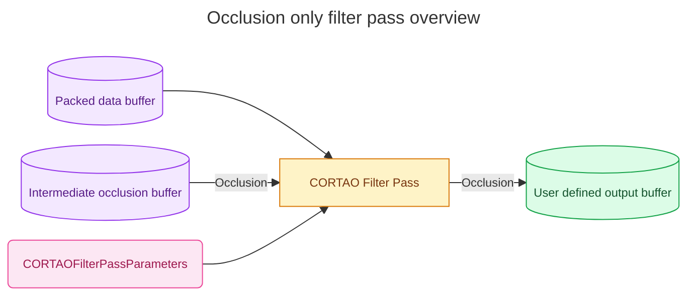
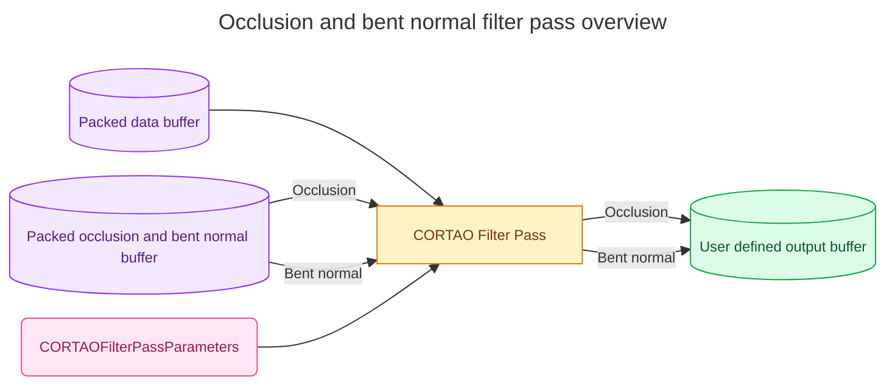

<h1>CORTAO Carbon Engine Implementation</h1>

[](https://www.youtube.com/watch?v=GUQ2kDgGT-c)

<h1>Table of contents</h1>

- [Introduction](#introduction)
  - [Reference implementation](#reference-implementation)
- [Benchmarks](#benchmarks)
  - [Simple scene test](#simple-scene-test)
  - [Complex scene test](#complex-scene-test)
- [Integration instructions](#integration-instructions)
  - [Overview](#overview)
  - [Shading language support](#shading-language-support)
  - [Graphics API support](#graphics-api-support)
  - [Coordinate system](#coordinate-system)
  - [Input resources](#input-resources)
  - [Output resources](#output-resources)
  - [Temporary intermediate resources](#temporary-intermediate-resources)
  - [Configuration parameters](#configuration-parameters)
  - [Input callbacks](#input-callbacks)
  - [Output callbacks](#output-callbacks)
  - [The prepass](#the-prepass)
  - [The main pass](#the-main-pass)
  - [The filter pass](#the-filter-pass)
  - [Shader Model 6.7 workarounds](#shader-model-67-workarounds)
  - [Performance recommendations](#performance-recommendations)
- [Version log](#version-log)
- [References](#references)
- [Contributing](#contributing)
- [License](#license)
  

<h1>Introduction</h1>

Circular Occluder Ray-Traced Ambient Occlusion, or CORTAO, is a new physically based real-time screen space ambient occlusion (SSAO) technique developed by [Daniel Isheden](https://www.linkedin.com/in/daniel-isheden/). Unlike existing state-of-the-art horizon-based SSAO techniques, CORTAO uses a completely new approach to physically based ambient occlusion derived from screen space raytracing to calculate occlusion and bent normals. Traditional depth buffer sampling is performed to constructs a simplified approximation of the neighborhood around each pixel consisting of circular occluders. Raytracing is then performed against this proxy geometry instead, allowing up to 32 rays per pixel to be efficiently traced for a fraction of the usual cost expected of screen space raytracing. The end result is a performant, highly scalable, physically correct SSAO technique.

<p align="center">
  
</p>

The Carbon Engine implementation is a streamlined version of CORTAO optimized for EVE: Frontier. It utilizes a maximum screen space radius to handle the extreme depth ranges of the EVE universe, providing high performance, high quality SSAO tailored for extremely large worlds.

<h2>Reference implementation</h2>

The more generalized reference implementation of CORTAO is available [here](https://github.com/carbonengine/CORTAO).

<h1>Benchmarks</h1>

In simple scenes, CORTAO converges to a similar level of error as GTAO, with accuracy only limited by the available screen space information. However, despite having a slightly higher per-sample cost than GTAO, CORTAO converges significantly faster, outperforming GTAO at all quality targets and performance budgets, especially at lower sample counts.

In spatially complex scenes with a large number of depth discontinuities where GTAO struggles, CORTAO is able to achieve a level of accuracy and quality that previously required hardware raytracing with significantly better results at all quality levels, converging to a much lower error than GTAO at higher sample counts.

In addition, CORTAO produces a much more consistent result that varies much less between different sample counts than GTAO, requiring no manual tweaking to maintain a consistent artistic style between different quality settings.

<h2>Simple scene test</h2>



<h2>Complex scene test</h2>



<h1>Integration instructions</h1>

CORTAO uses the same inputs and produces the same outputs as most competing SSAO techniques, and can generally be seen as a drop-in replacement for existing SSAO techniques. If your engine already has support for some form of SSAO, CORTAO should be especially easy to integrate.

<h2>Overview</h2>

CORTAO consists of three separate compute shader passes:
- A prepass, which generates a mipmapped packed buffer that contains a linear depth value and a low-precision spheremap-encoded normal.
- The main pass, which implements the core CORTAO algorithm to perform screen space raytracing against sampled occluders, and outputs occlusion and an optional bent normal.
- An optional filter pass, which prefilters the output of CORTAO in such a way that it interacts better with subsequent temporal filtering (not included), such as temporal anti-aliasing or temporal upscaling techniques (e.g. DLSS, FSR, XeSS, etc).




<h2>Shading language support</h2>

Carbon CORTAO is released as HLSL shader headers.

CORTAO relies on using the SampleLevel() and Gather() functions on integer format textures for performance. [This requires Shader Model 6.7 to be supported.](https://microsoft.github.io/DirectX-Specs/d3d/HLSL_SM_6_7_Advanced_Texture_Ops.html#integer-sampling), making this the minimum requirement for CORTAO. If you want to implement CORTAO on earlier shader models, see the workaround steps [here](#shader-model-67-workarounds).

<h2>Graphics API support</h2>

The Carbon Engine CORTAO shaders have been tested and confirmed working as is with:
- DirectX 11 (with Shader Model 6.7 workaround)
- DirectX 12

Other APIs can be used with CORTAO through cross-compilation of HLSL.

<h2>Coordinate system</h2>

CORTAO operates entirely in view space. In particular, <b><ins>the input normal is expected to be in view space, and the output bent normal is provided in view space.</ins></b> If your engine operates on normals in a different space, e.g. world space, you will need to transform the normals to and from view space as required. See the [prepass integration instructions](#the-prepass) and [main pass integration instructions](#the-main-pass) for more details on this.

CORTAO also places limits on which projection matrices are supported. This implementation of CORTAO supports perspective projection matrices only. With the exception of off-center projections, no other types of transformations are supported in the input projection matrix. See the [configuration parameter section for details](#projection-matrix). 


<h2>Input resources</h2>

Like most SSAO techinques, CORTAO expects a hardware depth buffer and a normal buffer as input. The exact format of the data in these 2D images is up to the user; refer to the table below for recommendations. In addition, two lookup tables, the occluder lookup table and bent normal lookup table, are needed for optimal performance.

| Resource name              | Resolution          | Recommended formats      | Description |
|----------------------------|---------------------|--------------------------|-------------|
| Depth buffer               | Screen resolution   | D32_SFLOAT               | The hardware depth buffer of the scene. Reverse depth D32_SFLOAT is recommended, but any depth format works. |
| Normal buffer              | Screen resolution   | At least 8 bit precision | The normal buffer of the scene. May be packed or encoded, but has to be decoded/unpacked/transformed into view space in input callbacks. 16-bit precision is recommended. |
| Occlusion lookup table     | Varies              | 8/16/32 bit UINT         | Lookup table for optimizing the occluder raytracing. |
| Bent normal lookup table   | 256 or 65536 element buffer | R8G8_SNORM       | Lookup table for optimizing the bent normal calculation. |

<h2>Output resources</h2>

CORTAO has a flexible output system that allows the user to store the output as they see fit. The following table contains examples of how the output of CORTAO <b>may</b> be stored. This should be used as reference when integrating CORTAO according to your own specific requirements.

| Stored data               | Format         | Description |
|---------------------------|----------------|-------------|
| Occlusion only            | R8_UNORM       | Occlusion stored as an 8-bit unsigned normalized value. |
| Occlusion and bent normal | R8G8B8A8_SNORM | Occlusion and bent normal packed into a single texture. 8-bit SNORM is enough for the occlusion value. |
| Encoded bent normal       | R8G8_SNORM     | The bent normal stored using spheremap or octahedral encoding to save memory. |


<h2>Temporary intermediate resources</h2>

These are resources that are needed to pass information between the various CORTAO compute shader passes. They do not need to be stored in a persistent manner; the memory used by these resources may be aliased and reused for other resources, as long as the data is kept intact for the CORTAO passes that utilize that specific resource.

| Resource name              | Resolution                         | Format   | Description |
|----------------------------|------------------------------------|----------|-------------|
| Packed data buffer         | Screen resolution with 1-8 mipmaps | R32_UINT | Packed data buffer containing linear depth and a low-precision sphere-map encoded normal. |
| Temporary occlusion buffer | Screen resolution                  | R8_UNORM | Buffer for passing the output of the main pass to the filter pass. Only required when using the filter pass without bent normals. |
| Packed occlusion and bent normal buffer | Screen resolution     | R32_UINT | Buffer for passing the output of the main pass to the filter pass. Only required when using the filter pass with bent normals. |

While many existing SSAO techniques are able to operate on an 16-bit linear depth buffer, this is not possible for CORTAO. As CORTAO requires pixel normals to be packed into the packed data buffer's lower bits, there is simply not enough space to store both linear depth and a packed normal in just 16 bits with sufficient precision. If you were previously using a 16-bit linear depth buffer for SSAO, switching to CORTAO will require a small amount of additional memory.

| Resolution | 16-bit depth | 32-bit depth | CORTAO packed data buffer |
|------------|--------------|--------------|---------------------------|
| 1920x1080  | 5.3 MB       | 10.5 MB      | 10.5 MB                   |
| 2560x1440  | 9.4 MB       | 18.8 MB      | 18.8 MB                   |
| 3840x2160  | 21.1 MB      | 42.2 MB      | 42.2 MB                   |


<h2>Configuration parameters</h2>

Each CORTAO pass expects a pass-specific parameter constant buffer to be provided. The values in these constant buffers are not intended to be tweaked directly; they are instead derived from a more intuitive set of user-tweakable configuration values. The struct for this is defined in [CORTAOParameters.h](src/CORTAOParameters.h).

```C
struct CORTAOConfigurationParameters {
	uint32_t width;
	uint32_t height;
	uint32_t mipCount;
	uint32_t randomSeed;

	bool flipY;
	bool isPerspective;
	float projectionMatrix[4][4];
	float inverseProjectionMatrix[4][4];
	float nearPlane;
	float farPlane;

	float maxScreenspaceRadiusHeightRatio = 0.2f;
	float mipBias = -4.0f;
	float maxSlopeCompensation = 4.0f;
	float backfaceThreshold = 0.5f;
	float backfaceBoost = 0.5f;

	//Filter parameters
	float filterDepthSensitivity = 512.0f;
	float filterNormalSensitivity = 16.0f;
};
```

<h3>uint32_t width, uint32_t height</h3>
The width and height of the frame. This much match the resolution of the input, output and intermediate 2D images. The valid range for both width and height is 1 to 65535.

<h3>uint32_t mipCount</h3>
The number of mipmaps in the packed data buffer. The range of allowed values is 1 to 8, inclusive.

<h3>uint32_t randomSeed</h3>
A random value is used to perform temporal animation. It should be set to a completely random 32-bit unsigned integer in the range 0 to 2^32-1, and should be rerandomized each frame. If no temporal filtering is used, this should be set to a constant value to avoid flickering.

<h3>bool flipY</h3>
Some graphics APIs (e.g. DirectX) has a mismatch between the Y directions of NDC (normalized device coordinate) space and texture coordinate space. As CORTAO does sample projection using the projection matrix, it may be necessary to flip the Y coordinate during the projection. This parameter should be set to true in those cases.

<h3 id="projection-matrix">float projectionMatrix[4][4]</h3>
The projection matrix used to render the scene. For performance reasons, CORTAO places heavy limitations on what kind of projection matrices are supported. The projection matrix:

- must be a standard perspective projection matrix.
- may have an off-center projection.
- must NOT have any rotation or translational components components (apart from an off-center projection).

More formally, projection matrices used with the Carbon Engine CORTAO implementation must be in this exact form:

$$
\begin{bmatrix}
a & 0 & b & 0 \\
0 & c & d & 0 \\
0 & 0 & e & f \\
0 & 0 & -1 & 0
\end{bmatrix}
$$

... where a, b, c, d, e and f can be any value, as long as the matrix remains invertible.

<h3>float inverseProjectionMatrix[4][4]</h3>

The exact inverse of ``projectionMatrix``.

<h3>float nearPlane, float farPlane</h3>

The near and far plane distances used to construct ``projectionMatrix``. Note that ``far`` may be smaller than ``near``, indicating that a reverse depth buffer is used. Both must be positive non-zero values, and one of the two may be +∞ for an infinite render distance. 

Note that some engines store the near and far plane distances in a non-reversed way and swap the two only when constructing the projection matrix. If you are using a reverse depth buffer, when passing the values to CORTAO ``near`` should be greater than ``far``.


<h3>float maxScreenspaceRadiusHeightRatio</h3>

The maximum screen space radius that CORTAO is allowed to sample, expressed as a fraction of the screen height. This is the primary way of controlling the radius of the Carbon Engine implementation of CORTAO, ensuring that CORTAO remains effective for scenes containing objects of very different scale.

The valid range is any positive non-zero value, but values above 0.5 will begin to excessively sample outside the screen. The recommended range is 0.1 to 0.25. This parameter is specified as a ratio of the ``height`` parameter so that the same value can be used for different resolutions, while maintaining an equivalent screen space area.

As an example, for a ``height`` of 1080 pixels and ``maxScreenspaceRadiusHeightRatio`` set to 0.25, CORTAO will at most sample a radius of 1080\*0.25 = 270, or a circular diameter of 540 pixels.

<h3>float mipBias</h3>

A mip level bias used to tweak the performance/quality of the sampling of the packed data buffer in the main pass. This value requires a careful balance to achieve both acceptable quality and good cache coherency, and should be tweaked with care, as an incorrectly set mip bias can cause either a drastic performance penalty, or severe visual artifacts.

A good default value is -4.0, providing acceptable quality and good cache coherency.

Values below -4.0 (e.g. -5.0) can increase temporal stability and accuracy, but can negatively affect performance if cache trashing starts to occurs. If a lower value is needed for acceptable quality, the cache thrashing induced by a low mip bias can be delayed by increasing the main pass compute shader workgroup size from 16x16 to 32x32.

Values closer to 0.0 can increase the performance by improving cache locality, but may introduce temporal instability (flickering), inaccurate results and in extreme cases self-occlusion artifacts.


<h3>float maxSlopeCompensation</h3>

When viewing a surface at an increasing view angle, the screen space area it covers becomes smaller and smaller. This is a limitation of operating only on screen space information that all SSAO techinques face. CORTAO automatically compensates for this effect by enlargening occluders to maintain a consistent result as the camera moves around.

As a surface viewed at a 90 degree angle becomes infinitely small and therefore requires an infinite slope compensation, it becomes necessary to at some point give up and let the occluder fade out. This value controls how much CORTAO is allowed to enlargen occluders to compensate for the view angle of surfaces.

A good default value is 4.0. The lowest acceptable value is 1.0, which results in no slope compensation being applied at all.

Values below 4.0 allow occluders to fade out faster, resulting in less popping, but causes a loss of occlusion on slopes.

Values above 4.0 provide a more view-independent result, but can cause popping and temporal stability issues as the view angle of surfaces approach 90 degrees.


<h3>float backfaceThreshold</h3>

CORTAO uses a heuristic to classify occluders as either front-facing or back-facing. This heuristic is necessary to both avoid self occlusion and prevent light bleeding through thin surfaces. It is not usually necessary to tweak this classification process, but this value allows makes it possible to do so if necessary.

A good default value is 0.5. The valid range is 0.0 to 1.0.

A smaller value reduces light bleeding through thin surfaces, but causes more self occlusion.

A higher value reduces self-occlusion, but reduces the occlusion behind thin surfaces.

If you are getting issues with light bleeding, it is recommended to first tweak the ``backfaceBoost`` parameter before trying to adjust this value.


<h3>float backfaceBoost</h3>

As an additional heuristic to prevent light bleeding through thin surfaces, backfaces can be given a more aggressive form of slope compensation. This value controls how much the occluder radii are boosted for such occluders.

A good default value is 0.0. The valid range is 0.0 to 1.0.

A value of 0.0 provides the most accurate result on average, but has more light bleeding and less intense shadows.

A value of 1.0 provides the most contrast, especially in highly complex geometry with limited screen space information, but can cause some overshadowing, especially on staircase-shaped geometry.


<h3>float filterDepthSensitivity</h3>

This value controls the depth sensitivity of the filter pass. A higher value results in less blurring over depth discontinuities. The filter pass compensates for the depth slope when testing neighboring pixels, allowing for a high sensitivity to be used without causing issues when viewing a surface at a high view angle.

A good default value is 512.0. The valid range is any positive value, including 0.0 which disables the depth check completely.

Games with mainly flat surfaces can increase the sensitivity further to improve sharpness, while games with more organic/rounded geometry should reduce the sensitivity to prevent excessive noise.


<h3>float filterNormalSensitivity</h3>

This value controls the normal sensitivity of the filter pass. A higher value results in less blurring between pixels with different normals.

A good default value is 16.0. The valid range is any positive value, including 0.0 which disables the normal check completely.

Games with mainly flat surfaces can increase the sensitivity further to improve sharpness, while games with more organic/rounded geometry should reduce the sensitivity to prevent excessive noise.


<h3>Non-photorealistic intensity tweaking</h3>

Since CORTAO is physically based, no "strength" parameter for tweaking the occlusion "intensity" is provided, as this would have no basis in reality. For physical correctness, the computed occlusion value should be applied as-is during ambient light calculation.

However, for non-photorealistic rendering, it may be desirable to tweak the computed intensity value to achieve a specific style or look. It is recommended to do this tweaking in the output callback of the main pass shader. There are many ways to implement this, but an simple way to do so is to exponentiate the output occlusion value. This can be implemented in the main pass output callback as `float tweakedOcclusion = pow(occlusion, intensity);`, where `intensity` is a user-controlled positive value. Intensity values between 0.0 and 1.0 will reduce the occlusion, while values above 1.0 will increase it.


<h2>Input callbacks</h2>

Each shader pass requires the user to implement a number of input callback function to perform the actual texture reads. Additionally, this allows the user to add conversions, transformations and unpacking as necessary before passing the data to CORTAO. For example, this allows the the user to:
- Unpack and/or transform the input normals into view space.
- Unpack a packed bent normal and occlusion value.

For optimal performance, input callback functions are expected to be implemented using specific types of texture reads based on their name:
- ``CortaoLoad*()``: HLSL ``Load()`` and GLSL ``texelFetch()`` using integer pixel coordinates.
- ``CortaoSample*()``: HLSL ``SampleLevel()`` and GLSL ``textureLod()`` using normalized texture coordinates.
- ``CortaoGather*()``: HLSL ``Gather()`` and GLSL ``textureGatherOffset()`` using normalized texture coordinates and a constant offset.


<h2>Output callbacks</h2>

CORTAO features a flexible output system where each shader pass has an output callback function, allowing the user to store the output of each pass in any way they want. This allows the user to both select what data to store, and how to store it. For example, this allows the the user to:
- Pack the output data as they see fit, for example packing occlusion and bent normal into a single RGBA image.
- Transform and/or apply an octahedral/spheremap encoding to the bent normals.
- Tweak the computed occlusion value to achieve a specific stylized non-photorealistic look.

<h2>The prepass</h2>

The prepass is responsible for populating the packed data buffer and all its mipmaps. This is done by linearizing the input depth buffer, then inserting a low-precision encoding of the input normal buffer into the least significant bits. Finally, it recursively downsamples the packed data to generate all mipmaps, all in a single compute shader. The produced packed data buffer allows the main pass to be computed much more efficiently, improving performance and cache coherency.



<h3>Defines</h3>

``CORTAO_PACKED_NORMAL_BITS``
- The number of bits to use in the packed data buffer for the low precision normal.
- Valid values are even values from 4 to 20.
- If left unspecified, it defaults to 10.
- The value of this define must be the same for all CORTAO passes.

<h3>Input callbacks</h3>

``float CortaoLoadDepth(int2 pixelCoords)``
- Loads a hardware depth value from the user-provided input depth buffer.
- This callback is only called for pixels within the image bounds, so no bounds checking is needed.

``float CortaoLoadNormal(int2 pixelCoords)``
- Loads a normal from the user-provided input normal buffer.
- <ins>The user is responsible for converting the normal to a normalized view space normal in the range [-1, +1]</ins>:
  - If the normal is packed/encoded, it must first be unpacked/decoded to a 3D vector before being passed to CORTAO.
  - If the normal is not in the [-1, +1] range, it must be converted to this range before being passed to CORTAO.
  - If the normal is not in view space, it must be converted to view space before being passed to CORTAO.
- This callback is only called for pixels within the image bounds, so no bounds checking is needed.
  
<h3>Output callbacks</h3>

``void CortaoWritePackedData(int2 pixelCoords, int mipLevel, uint data)``
- Writes 32 bits of packed data to a specific coordinate in a specific mip level of the packed data buffer.
- This callback is only called for pixels within the image bounds, so no bounds checking is needed.
- This callback is only called for mip levels less than ``CORTAOConfigurationParameters::mipCount``, so no check is needed.

<h3>Constant buffer data</h3>

The prepass requires access to a ``CORTAOPrepassParameters`` struct populated by the ``CORTAO::PopulatePrepassParameters()`` function in [CORTAOParameters.h](src/CORTAOParameters.h).

Any user data needed to unpack and/or convert the input normal to view space will need to be included in the constant buffer as well.

<h3>Workgroup size</h3>

The recommended workgroup size for the prepass is 8x8. Smaller workgroup sizes improves the efficiency of the mipmap generation by stalling fewer threads.

<h3>Reference implementations</h3>

- [Reference implementation](src/shaders/reference/CORTAOPrepassReference.hlsl)

<h2>The main pass</h2>

The main pass contains the implementation of the CORTAO algorithm. It samples the packed data buffer to construct an approximation of the local screen space neighborhood around pixel made entirely of circular occluders, then raytracing these occluders with a large number of rays. The occlusion state of each ray is then used to calculate both occlusion and bent normals.

The main pass uses up to two lookup tables, depending on which preprocessor defines are enabled. Precomputed lookup tables are available [here](tables).




<h3>Defines</h3>

``CORTAO_PACKED_NORMAL_BITS``
- The number of bits to use in the packed data buffer for the low precision normal.
- Valid values are even values from 4 to 20.
- If left unspecified, it defaults to 10.
- The value of this define must be the same for all CORTAO passes.

``CORTAO_SAMPLE_COUNT``
- Set to the number of samples CORTAO will perform per pixel.
- This is the primary quality/performance tradeoff of CORTAO.
- Must be at least 1.
- The recommended range is 4 to 32.
- Note that this value must be defined to a constant to allow the sampling loop to be unrolled, or performance will greatly suffer.
- To support multiple quality levels of CORTAO, it is necessary to have multiple permutations of this shader pass. See the [performance recommendations](#performance-recommendations) for more information.

``CORTAO_RAY_COUNT``
- The number of rays CORTAO will trace per pixel.
- Must be between 8 and 32.
- If ``CORTAO_OCCLUDER_LOOKUP_TABLE`` is set to 1, then ``CORTAO_RAY_COUNT`` must be a power of two and match the number of rays the lookup table was generated for.

``CORTAO_OCCLUDER_LOOKUP_TABLE``
- Set to 1 to use a lookup table to perform bulk raytracing instead of tracing each ray individually.
- <ins>This is required for good performance</ins> and should only be disabled for testing/debugging.
- The sampled lookup table must have been generated for ``CORTAO_RAY_COUNT`` rays per pixel.
- Precomputed lookup tables are available [here](tables/occluder).

``CORTAO_BENT_NORMAL_LOOKUP_TABLE``
- Set to 1 to use a lookup table to compute bent normals.
- This is recommended as it reduces the overhead of computing bent normals, but is not strictly necessary.
- The sampled lookup table must have been generated for ``CORTAO_RAY_COUNT`` rays per pixel.
- Note that currently a lookup table can only be used with 8 and 16 rays; there is no lookup table for 32 rays due to the large number of combinations of possible ray states.
- Precomputed lookup tables are available [here](tables/normal).

<h3>Input callbacks</h3>

``float3 CortaoLoadNormal(int2 pixelCoords)``
- Loads a normal from the user-provided input normal buffer.
- <ins>The user is responsible for converting the normal to a normalized view space normal in the range [-1, +1]</ins>:
  - If the normal is packed/encoded, it must first be unpacked/decoded to a 3D vector before being passed to CORTAO.
  - If the normal is not in the [-1, +1] range, it must be converted to this range before being passed to CORTAO.
  - If the normal is not in view space, it must be converted to view space before being passed to CORTAO.
- This callback is only called for pixels within the image bounds, so no bounds checking is needed.

``uint CortaoSamplePackedData(float2 texCoords, float mipmap)``
- Samples a specific mipmap of the packed data buffer using normalized texture coordinates.
- For the sampler, use nearest filtering with <ins>border clamping</ins> and a border "color" of ``0u`` ("black").

If ``CORTAO_OCCLUDER_LOOKUP_TABLE`` is defined to 1:
- ``uint CortaoSampleOccluderLookupTable(float3 texCoords)``
  - Samples the occluder lookup table using normalized 3D texture coordinates.
  - For the sampler, use nearest filtering with <ins>clamp-to-edge</ins>.
  
If ``CORTAO_BENT_NORMAL_LOOKUP_TABLE`` is defined to 1:
- ``float3 CortaoLoadBentNormalLookupTable(uint rayBits)``
  - Loads a tangent space bent normal from the bent normal lookup table using the ray occlusion bits as offset.
  - For the provided [bent normal lookup tables](tables/normal), this also requires reconstructing the Z-coordinate of the bent normal as ``z = sqrt(1.0 - x*x - y*y);``.
	
  
<h3>Output callbacks</h3>

``void CortaoWriteResult(int2 pixelCoords, float occlusion, float3 bentNormal, float3x3 tangentSpaceTransform, uint rayBits)``
- Writes a number of values to a user-specified output buffer.
- The user is free to select, pack and transform the values as necessary for their specific use case.
  - ``float occlusion``: The SSAO value, intended to be used as multiplier for incoming ambient light.
  - ``float3 bentNormal``: The bent normal, intended to be used for sampling ambient light.
  - ``float3x3 tangentSpaceTransform``: Contains the tangent space transform, allowing the view space ray directions to be reconstructed. The tangent space ray directions can be retrieved by calling ``cortao_rayDirection(uint index)``.
  - ``uint rayBits``: Contains the exact ray occlusion state. Together with the tangent space transform, this can be used to perform more exact ambient light sampling than a bent normal can provide by sampling individual ray directions.
- Output buffer recommendations:
  - When outputting occlusion only, it is recommended to write ``occlusion`` to an R8_UNORM image.
  - When outputting occlusion and bent normals without a subsequent filter pass, it is recommended to write both to an R8G8B8A8_SNORM image.
	- Alternatively, ``occlusion`` can be written to an R8_UNORM image and ``bentNormal`` can be encoded using e.g. octahedral encoding into an R8G8_SNORM image to save memory.
  - When outputting occlusion and bent normal with a subsequent filter pass, it is recommended to manually pack the data to an R32_UINT to be able to utilize the gather-based optimizations of the filter pass.
- This callback is only called for pixels within the image bounds, so no bounds checking is needed.

<h3>Constant buffer data</h3>

The main pass requires access to a ``CORTAOMainPassParameters`` struct populated by the ``CORTAO::PopulatePrepassParameters()`` function in [CORTAOParameters.h](src/CORTAOParameters.h).

Any user data needed to unpack and/or convert the input normal to view space will need to be included in the constant buffer as well, as well as user data needed to convert and/or pack the output bent normal.

<h3>Workgroup size</h3>

The workgroup size is an important consideration for the main pass. Larger workgroups result in the better spatial cache coherency when sampling the packed data buffer, allowing a higher mip bias to be used without inducing cache trashing. However, a larger workgroup size also reduces the flexibility of the work scheduling the GPU can do, which can in turn can result in worse utilization of the GPU compared to smaller workgroup sizes, reducing average performance.

The recommended workgroup size for the main pass is 16x16 to provide a good balance between cache coherency and GPU utilization. If using a higher mip bias than the recommended value or running CORTAO on hardware with limited memory bandwidth, try to increase the work group size to 32x32 and remeasure performance.

<h3>Reference implementations</h3>

- [Occlusion only implementation](src/shaders/reference/CORTAOMainPassOcclusionReference.hlsl)
- [Occlusion and bent normal implementation](src/shaders/reference/CORTAOMainPassBentNormalReference.hlsl) (when used directly, without a subsequent filter pass)
- [Packed occlusion and bent normal implementation](src/shaders/reference/CORTAOMainPassPackedBentNormalReference.hlsl) (when used with a subsequent filter pass)

<h2>The filter pass</h2>

The optional filter pass is responsible for applying a cheap, sparse blur to the output of the main pass, effectively prefiltering the output to be more compatible with subsequent temporal filtering. It can filter both occlusion and bent normals.






<h3>Defines</h3>

``CORTAO_PACKED_NORMAL_BITS``
- The number of bits to use in the packed data buffer for the low precision normal
- Valid values are even values from 4 to 20.
- If left unspecified, it defaults to 10.
- The value of this define must be the same for all CORTAO passes.

``CORTAO_FILTER_BENT_NORMAL``
- Set to 1 if filtering both occlusion and bent normals.
- Set to 0 to only filter occlusion
- This define affects the input and output callback function signatures.

``CORTAO_LARGE_FILTER``
- Set to 1 to use a larger 13 tap filter instead of a faster 5 tap filter.

``CORTAO_FILTER_SYMMETRY``
- Set to 1 to enforce symmetrical/centered kernel weights to prevent skewed kernel centers.
- Enabling this define improves contact shadows, but provides less filtering near edges, potentially resulting in more noise.
  
<h3>Input callbacks</h3>

``uint4 CortaoGatherPackedData(float2 texCoords, int2 offset)``
- Gathers 4 texels from the packed data buffer using normalized texture coordinates and a constant pixel offset.
- For the sampler, use nearest filtering with <ins>border clamping</ins> and a border "color" of ``0u`` ("black").

If ``CORTAO_FILTER_BENT_NORMAL`` is defined to 1:
- ``float4x4 CortaoGatherSSAO(float2 texCoords, int2 offset)``
  - Gathers 4 texels of packed occlusion and bent normal data written by main pass using normalized texture coordinates and a constant pixel offset.
  - In this case, the occlusion and bent normal output of the main pass should be manually packed and stored in an R32_UINT image to allow the data to be gathered in a single operation.
  - The sampled packed occlusion and bent normal data must be unpacked into a ``float4x4`` matrix of data.
  
Else:
- ``float4 CortaoGatherSSAO(float2 texCoords, int2 offset)``
  - Gathers 4 texels of occlusion written by the main pass using normalized texture coordinates and a constant pixel offset.
  - In this case, the occlusion output of the main pass should be stored in an R8_UNORM image.

<h3>Output callbacks</h3>

If ``CORTAO_FILTER_BENT_NORMAL`` is defined to 1:
- ``void CortaoWriteFilterOutput(int2 pixelCoords, float4 ssao)``
  - Writes an occlusion value and bent normal to a user-specified output buffer.
	- It is recommended to write both occlusion and bent normals into an R8G8B8A8_SNORM image.
	- Alternatively, occlusion can be written to an R8_UNORM image and the bent normal can be encoded using e.g. octahedral encoding into a separate R8G8_SNORM image to save memory.
  - This callback is only called for pixels within the image bounds, so no bounds checking is needed.
  
Else:
- ``void CortaoWriteFilterOutput(int2 pixelCoords, float ssao)``
  - Writes an occlusion value to a user-specified output buffer.
    - It is recommended to write the occlusion value to an R8_UNORM image.
  - This callback is only called for pixels within the image bounds, so no bounds checking is needed.

<h3>Constant buffer data</h3>

The filter pass requires access to a ``CORTAOFilterPassParameters`` struct populated by the ``CORTAO::PopulatePrepassParameters()`` function in [CORTAOParameters.h](src/CORTAOParameters.h).

<h3>Workgroup size</h3>

The filter pass operates in a different way from the other passes. Each compute shader thread of the filter pass shader processes 4 pixels in a 2x2 area. This allows it to take advantage of the texture gather functionality of modern GPUs to effectively sample 4 pixels using a single gather operation, greatly improving performance.

The recommended workgroup size is 8x8, which effectively results in each workgroup processing a 16x16 tile of pixels. Make sure to take this into consideration when dispatching the compute shader for this pass.

<h3>Reference implementations</h3>

- [Occlusion only implementation](src/shaders/reference/CORTAOFilterPassOcclusionReference.hlsl)
- [Occlusion and bent normal implementation](src/shaders/reference/CORTAOFilterPassBentNormalReference.hlsl) (expects the output of the main pass to be packed)

<h2>Shader Model 6.7 workarounds</h2>

When compiling CORTAO as HLSL, Shader Model 6.7 is required for integer texture format sampling support. This requirement can be worked around, although with some performance penalties, especially for the filter pass when bent normals are enabled. Here are the necessary changes to do so:

- Change the format of the packed data buffer from R32_UINT to R32_SFLOAT, and use ``asfloat()`` and ``asuint()`` to convert the packed data between float and uint.
- Use a UNORM version of the occluder lookup tables. More information can be found [here](tables/occluder#shader-model-67-workaround).
- The filter pass relies heavily on the ``Gather()`` function for performance. When filtering both occlusion and bent normals, instead of using a packed R32_UINT format as input it is possible to use a non-packed R8G8B8A8_SNORM format and to perform one ``Gather()`` for each of the RGBA color channels, at the cost of some performance.

<h2>Performance recommendations</h2>

This section contains a number of tips and tricks for maximizing CORTAO performance.

<h3>General performance tips</h3>

- It's not always necessary to generate all 8 mipmaps of the packed data buffer. Down to a resolution of 64x64 or so is generally enough. A way to calculate the exact worst case mip level that CORTAO will use from the parameters may be added in the future.
- Placing the per-pass parameter structs in root/push constants is slightly faster than uniform buffers, as some GPUs are able to preload the data into registers instead of relying on buffer reads.
- Using inline/embedded/immutable samplers can be sligtly faster, as the sampler states can be hardcoded into the shader instead of read from descriptor heap memory.

<h3>Main pass performance tips</h3>

- The sample count (``CORTAO_SAMPLE_COUNT``) is the primary quality/performance trade-off setting. Note that this value must be a constant to allow the loop to be unrolled, so shader permutations are required to support multiple quality settings.
- The mip bias parameter is critical for performance, as a too large value there can cause excessive cache thrashing and greatly reduce performance.
- For AMD GPUs, it is recommended to manually set the subgroup size to 64 when possible, as this can double the effective occupancy and greatly improve performance.
  - For DirectX 12, Shader Model 6.6 allows HLSL shaders to specify the wave size as ``[WaveSize(64)]`` before the ``main()`` function definition.
    - Note that this is a hard requirement and will fail if the GPU does not support this wave size. It is therefore recommended to compile a separate permutation that is only used when the GPU advertises a maximum wave size of 64.
    - The supported wave sizes of the GPU can be queried using ``D3D12_FEATURE_DATA_D3D12_OPTIONS1::WaveLaneCountMin`` and ``D3D12_FEATURE_DATA_D3D12_OPTIONS1::WaveLaneCountMax``.
  - Vulkan 1.3 provides subgroup size control by chaining a ``VkPipelineShaderStageRequiredSubgroupSizeCreateInfo`` struct to the ``VkPipelineShaderStageCreateInfo`` of the compute shader of the main pass.
    - The range of supported subgroup sizes can be queried using the ``VkPhysicalDeviceSubgroupSizeControlProperties`` struct.

<h1>Version log</h1>

- 1.00 (2026-11-05): Initial release.

<h1>References</h1>

- [Jimenez et al., 2016]: GTAO, Practical Realtime Strategies for Accurate Indirect Occlusion, Jimenez et al., 2016, https://www.activision.com/cdn/research/Practical_Real_Time_Strategies_for_Accurate_Indirect_Occlusion_NEW%20VERSION_COLOR.pdf

- [Frisvad, J. R., 2012]: Building an orthonormal basis from a 3d unit vector without normalization. Journal of Graphics Tools 16(3), pp. 151-159, August 2012.
https://backend.orbit.dtu.dk/ws/portalfiles/portal/126824972/onb_frisvad_jgt2012_v2.pdf


<h1>Contributing</h1>

Contributions are welcome. Please read the Carbon Engine [contributing guide](https://github.com/carbonengine/.github/blob/main/CONTRIBUTING.md) before opening an issue or pull request. It covers the workflow, the CLA and the pull request template, and applies to every `carbonengine` repository. Please also follow the [Code of Conduct](https://github.com/carbonengine/.github/blob/main/CODE_OF_CONDUCT.md), and report security issues privately as described in the [Security Policy](https://github.com/carbonengine/.github/blob/main/SECURITY.md) rather than in a public issue.

By submitting a pull request or otherwise contributing to this project, you agree to license your contribution under the [MIT License](LICENSE.md), and you confirm that you have the right to do so.

<h1>License</h1>License

© 2026 Fenris Creations

This software is provided by Fenris Creations.

Trademark Notice: Fenris Creations is a trademark of CCP ehf.

This project is licensed under the [MIT License](LICENSE). Nothing in the [MIT License](LICENSE) grants any rights to Fenris Creations' trademarks or game content.
